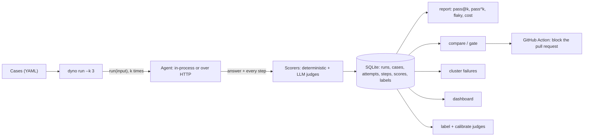

# Dyno

[](https://github.com/Utsav0706/dyno/actions/workflows/ci.yml)

An evaluation harness for AI agents. Dyno runs an agent on a set of test cases, several
times each, records every step it takes (model calls, tool calls, results), scores each
attempt, compares runs, and fails a pull request when the agent gets worse.

Not just "was the final answer right?" but: did it use the right tools, in a sensible
number of steps, without making things up, at what cost, and does it pass every time
or only sometimes?

One of four connected projects: [Scout](https://github.com/Utsav0706/scout) (research
agent), [Gearbox](https://github.com/Utsav0706/gearbox) (LLM router), Dyno (eval
harness) and Pitwall (LLMOps).

## What it found

**It found Scout's biggest weakness, and measured the fix.** Grouping Scout's failures
(`dyno cluster`) showed most were reports that stopped at "the sources don't give X"
instead of searching for X. Scout's writer now names follow-up questions for its retry
round. Same 10 hard cases, 3 attempts each, same calibrated judges
([reports/m8-before-after.md](reports/m8-before-after.md)):

| | Before | After |
|---|---|---|
| Task success (attempts) | 47% | **80%** |
| Cases right every time (pass^3) | 4/10 | **7/10** |
| Cases that got worse | | 0 |
| Cost per question | GBP 0.0247 | GBP 0.0322 (**+30%**) |

The fix was designed from these cases, so the fair test is the other 40 golden cases;
a full 50-case run is planned.

**Its CI gate blocked a bad change that every unit test passed.** A Scout pull request
that looked like a cost cut (read 2 sources instead of 8) passed Scout's unit tests,
which use scripted models. The gate ran 5 cases on `main` and on the pull request:
task success fell from 80% to 40%, and the "cost cut" cost 26% more per question
([reports/m9-gate-demo.md](reports/m9-gate-demo.md)).

**Its judges are checked against a person.** 40 Scout answers and 30 claims labelled
by hand, blind to the judges ([reports/calibration.md](reports/calibration.md)):

| Judge (Claude Haiku 5.5) | Cohen's kappa |
|---|---|
| task_rubric: are the expected key points in the answer? | 1.00 |
| quality v2 (v1 was 0.56: it marked answers down for their format) | 0.95, measured on the labels it was tuned on |
| hallucination: is each claim supported by what the agent read? | 0.63 |

**Agents are less reliable than one run suggests.** On Scout's 10-case subset, pass@3
was 60% but pass^3 40%, and the same code scored 70% in one run and 47% in another.
Dyno reports flaky cases and gates on k = 3. Baseline for Scout and Gearbox:
[reports/baseline](reports/baseline/README.md).

## How it works



Design, storage and every decision with its reason: [docs/design.md](docs/design.md).
How it compares with Inspect, promptfoo and DeepEval (short answer: they are bigger and
better for most work): [docs/comparison.md](docs/comparison.md). Questions:
[docs/faq.md](docs/faq.md).

## Run it locally (Windows PowerShell)

```powershell
py -m venv .venv
.venv\Scripts\python.exe -m pip install -e ".[dev]"
.venv\Scripts\dyno.exe --help
.venv\Scripts\python.exe -m pytest
```

On Linux/CI the same steps are `make install` and `make check`.

## Try it (free, no API key)

```powershell
.venv\Scripts\dyno.exe run examples\example_suite.yaml --agent example --k 3
```

This runs the built-in example agent (deterministic, with a calculator and a lookup tool)
on 6 cases, 3 times each. Each attempt and its steps go into `dyno.db` (set
`DATABASE_URL` to change that). The database schema is created and upgraded
automatically. It prints a run id; then:

```powershell
.venv\Scripts\dyno.exe report <run_id>               # Markdown; --format json, --out FILE
.venv\Scripts\dyno.exe score <run_id>                # re-score a stored run, agent not called
```

## Scorers

Each scorer returns a score (0 to 1), pass/fail, and a one-line reason. "Not
applicable" (for example, no `max_steps` on the case) never counts as a pass or a fail.

| Scorer | Checks |
|---|---|
| `task_success` | answer vs `expected`: `contains` (default), `exact` or `regex`; key-point lists score the share found; `check: module:function` for your own check |
| `tool_correctness` | every `must_call` tool was called and no `must_not_call` tool was |
| `trajectory_efficiency` | steps (model and tool calls) within `max_steps`; no tool called 3+ times with the same arguments |
| `cost_latency` | cost (GBP), time and tokens; pass/fail only with `max_cost_gbp` / `max_latency_s` |
| `task_rubric` (judge) | every expected key point covered, in any wording, and none contradicted; for an `unanswerable` case, says the evidence isn't there without inventing an answer |
| `hallucination` (judge) | share of the answer's factual claims that the evidence the agent received (its tool results, plus the case's `sources`) doesn't support; passes at <= 10% |
| `quality` (judge) | correct, helpful and clear, 1-5 each; passes when correct and helpful are both >= 4 |

Judge scorers call Claude Haiku 5.5 (`ANTHROPIC_API_KEY` in `.env`), cost under GBP
0.001 a call, and stop at `JUDGE_BUDGET_GBP` (default GBP 1 per command). Their prompts
are versioned files in [src/dyno/prompts/](src/dyno/prompts/), and every judged score
stores the prompt version, model, tokens, cost and the judge's full verdict. The pass
rules are in code, not in the prompts. If a judge call fails, that score counts as a
scorer error, never as an agent failure. Judges only run when a suite lists them.

An attempt passes when every scorer that applied passed. Across the k attempts of a case,
the report gives **pass@k** (at least one passed), **pass^k** (all passed) and the
**flaky** cases (some passed, some failed). Choose scorers per suite:

```yaml
scorers:
  - task_success: {mode: exact}
  - tool_correctness
  - cost_latency: {max_cost_gbp: 0.05}
```

Add scorers to a run you already have, without calling the agent again:
`dyno score <run_id> --suite suites/scout.yaml`.

## Compare runs, gate releases, find failure patterns

```powershell
.venv\Scripts\dyno.exe compare BASE_RUN NEW_RUN           # metric changes, newly failing cases
.venv\Scripts\dyno.exe gate NEW_RUN --baseline BASE_RUN    # exit 1 if a pass rate dropped > 2 pts
.venv\Scripts\dyno.exe cluster RUN [RUN...]               # group failures, name each group
.venv\Scripts\dyno.exe import-failures prod.jsonl --out runs\new_cases.yaml
```

`gate` is also a Python function (`from dyno.gate import gate`), so a release script can
call it directly. `cluster` embeds failure explanations locally (needs
`pip install -e ".[cluster]"`), groups them with k-means (k chosen by silhouette, at most
the square root of the number of failures) and asks the judge for a one-line name per
group. Formats and the Python API: [docs/integration.md](docs/integration.md).

## Gate pull requests (GitHub Action)

`uses: Utsav0706/dyno@main`, twice in one job: with `role: baseline` after starting
your agent from the base branch, and with `role: candidate` after starting it from the
pull request. The second step compares the two runs, writes the comparison to the job
summary and fails if the score dropped by more than you allow. Inputs, Scout's
workflow as an example, and how to pick a threshold: [docs/ci-gate.md](docs/ci-gate.md).
Each gate runs your agent twice, so run it on a label, not on every push.

## Dashboard

```powershell
.venv\Scripts\python.exe -m pip install -e ".[dashboard]"
.venv\Scripts\dyno.exe dashboard          # http://localhost:8501
```

A local, read-only Streamlit view of the store:

- **Runs:** every run with its pass rates and cost, and each scorer's pass rate over time
  for a suite.
- **Run:** scorers, tags and flaky cases. Click a case to see each attempt's answer,
  every score with its reason and the judge's full verdict, and the trajectory step by
  step.
- **Compare:** two runs side by side, with the gate's verdict for a metric and threshold
  you pick.
- **Clusters:** files saved with `dyno cluster RUN --format json --out reports\clusters.json`.

Its numbers come from the same code as `dyno report` and `dyno compare`.

## Checking the judges against a human

```powershell
.venv\Scripts\dyno.exe import runs\ci-123\dyno.db      # bring a CI run's database in
.venv\Scripts\dyno.exe label task                      # you mark answers pass/fail, blind
.venv\Scripts\dyno.exe label claims                    # and single claims supported or not
.venv\Scripts\dyno.exe calibrate --out reports\calibration.md
```

`label` never shows the judge's verdict, saves each label as you go (quit with `q`,
carry on later), and samples every item the judge failed plus a random share of the
rest. `calibrate` reports Cohen's kappa per judge (agreement corrected for chance; 0.6
or more counts as trusted) and lists every disagreement with the judge's reason.

## Plug in an agent

An agent is anything with a `run(input: str) -> AgentResult` method. It doesn't need to
inherit from anything:

```python
from dyno.agent import AgentResult, Step


class MyAgent:
    def run(self, input: str) -> AgentResult:
        return AgentResult(
            final_answer="...",
            steps=[Step(type="tool_call", name="web_search", args={"q": input})],
        )
```

Run it with `dyno run suite.yaml --agent mypackage.agents:MyAgent`. The case format is
documented at the top of [src/dyno/cases.py](src/dyno/cases.py), and an example is in
[examples/example_suite.yaml](examples/example_suite.yaml). Run part of a suite with
`--tags web --tags docs` or `--ids case-1 --ids case-2`.

## Built-in adapters

| Agent | Talks to | Each attempt |
|---|---|---|
| `scout` | Scout's API (`SCOUT_URL`, default `http://127.0.0.1:8001`) | signs up a fresh user per run, uploads PDFs from `SCOUT_CORPUS_DIR` if set, starts a research job, waits for it, then reads its trajectory (every model and tool call) |
| `gearbox` | Gearbox's OpenAI-style API (`GEARBOX_URL`, default `http://127.0.0.1:8002`) | one chat completion with `model: auto`; the chosen model, cost and routing reason come from Gearbox's headers |

Scout's golden set is already in Dyno's format:

```powershell
.venv\Scripts\dyno.exe run "..\scout\eval\golden.yaml" --agent scout --tags web
.venv\Scripts\dyno.exe run examples\gearbox_smoke.yaml
```

Scout's document cases need Postgres with pgvector, so they run in GitHub Actions: the
manual [eval workflow](.github/workflows/eval.yml) starts Scout next to Dyno and uploads
the run's database and report.

## Cost and limits

- **Spend so far:** under GBP 4 of API calls for everything in `reports/`: the
  baseline, calibration, the M8 before/after and the gate demo. Most of it is Scout's
  own cost (about GBP 0.02-0.03 a question); judges are about GBP 0.0025 per answer.
- **Small samples.** The headline results are on 10 and 5 cases. They show large
  effects, not precise ones, and the M8 fix was designed from the cases it was measured
  on.
- **The hallucination judge is the least trusted** (kappa 0.63), and quality v2's
  0.95 is optimistic: it was measured on the labels it was tuned on.
- **Noise.** Agents and the live web vary; one run at k = 1 can move 20+ points.
- **Scale.** SQLite and a sequential runner: fine for 50 cases x 3, slow for thousands.
  Judges only through Anthropic. No sandboxes, no red teaming.

## Repository layout

| Path | What |
|---|---|
| `src/dyno/cases.py`, `agent.py`, `runner.py` | case format, the agent contract, running a suite |
| `src/dyno/agents/` | example, Scout and Gearbox adapters |
| `src/dyno/scoring/` | deterministic scorers, judges, pass@k / pass^k |
| `src/dyno/judge.py`, `prompts/` | the judge client (budget, cost) and versioned prompts |
| `src/dyno/store/`, `migrations/` | SQLAlchemy tables and Alembic migrations |
| `src/dyno/report.py`, `compare.py`, `gate.py`, `cluster.py` | reading runs |
| `src/dyno/labelling.py`, `calibration.py` | hand labels and Cohen's kappa |
| `src/dyno/dashboard/` | Streamlit dashboard |
| `action.yml` | the GitHub Action |
| `suites/`, `examples/` | Scout and Gearbox suites; free example suites |
| `reports/` | baseline, calibration, clusters, M8 and M9 results |
| `docs/` | design, comparison, FAQ, CI gate, integration |

## How it was built

| Step | What |
|---|---|
| M0 | Skeleton: typed config, JSON logging, tests, CI |
| M1 | Case format, agent contract, runner with k repeats, SQLite store with migrations |
| M2 | Deterministic scorers, pass@k / pass^k, reports |
| M3 | HTTP adapters for Scout and Gearbox; Scout eval in GitHub Actions |
| M4 | Three LLM judges with versioned prompts and a budget |
| M5 | Baseline: Scout 50 x 1 and 10 x 3, Gearbox 119 prompts |
| M6 | Blind hand labels and Cohen's kappa; quality judge v2 |
| M7 | Compare, gate, failure clustering, production failures to cases |
| M8 | Fixed Scout's biggest failure cluster; before/after |
| M9 | Dashboard, GitHub Action, gate demo on a deliberately bad pull request |
| M10 | Design doc, comparison, FAQ, this README |
