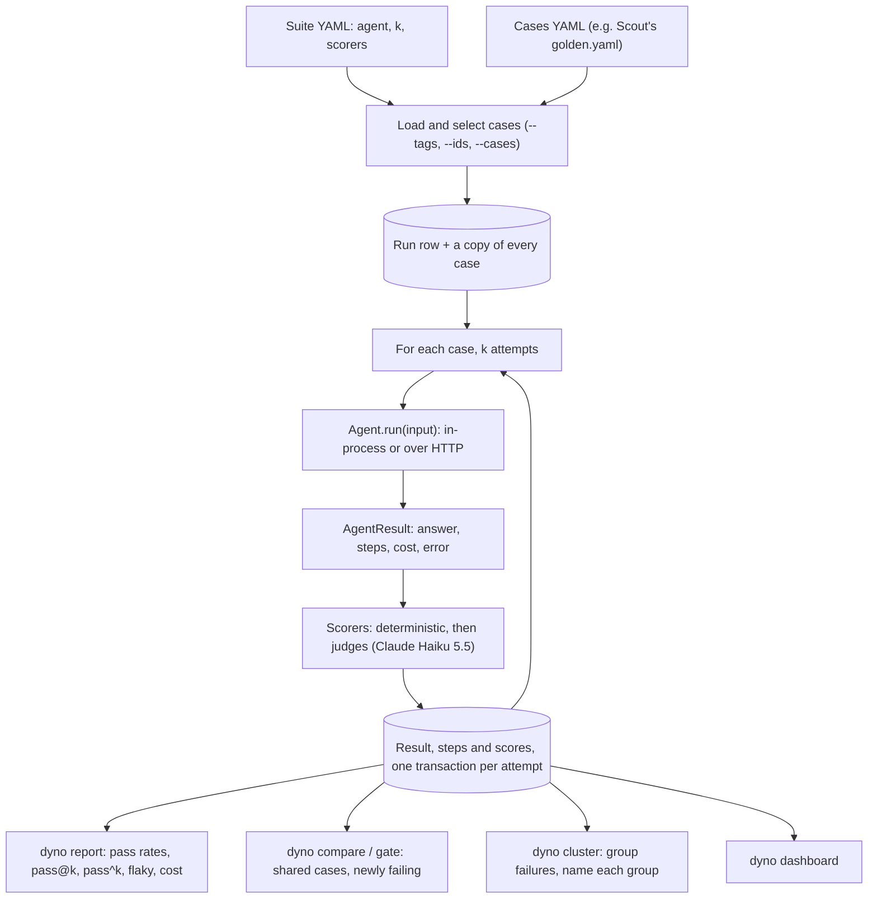
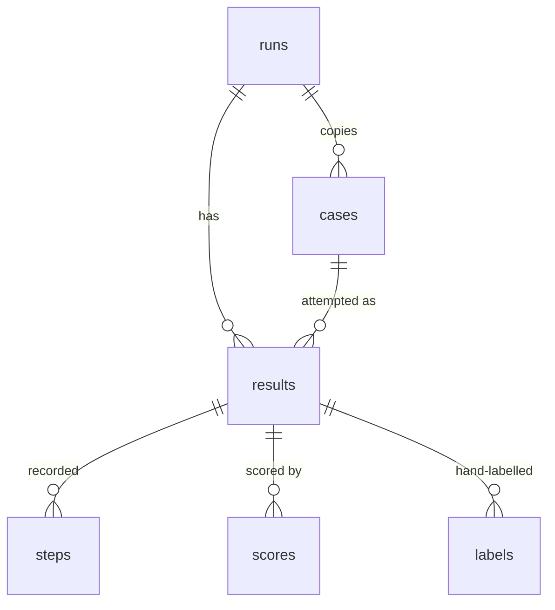

# Dyno design

Dyno runs an agent on a set of cases, records every step of every attempt, scores each
attempt, and answers three questions about a run: how good is it, how reliable is it,
and is it worse than the last one? This document explains how a run flows through
Dyno, how the data is stored, how the judges are kept honest, and why each part is
built the way it is.

## 1. A run, step by step



1. **Load.** A suite file holds settings (agent, k, scorers) and usually the cases. With
   `--cases`, the cases come from another file, so Scout's golden set stays in Scout's
   repo and Dyno reads it as is.
2. **Snapshot.** The run row stores the suite's scorer settings and a copy of every
   case it ran, plus Dyno's version, the git commit and a hash of the configuration.
3. **Attempt.** Dyno times `agent.run(input)` itself. An exception becomes an attempt
   with an error, not a crash: the run carries on.
4. **Score.** Every scorer gets the case and the attempt and returns a score from 0 to
   1, pass / fail / not applicable, and a one-line reason.
5. **Save.** Each attempt, its steps and its scores are written in one transaction, so
   an interrupted run keeps everything it finished.

`dyno score RUN` re-runs scorers on stored attempts without calling the agent again:
it's how new judges were tried on old runs for a fraction of a penny.

## 2. The agent contract

```python
class Agent(Protocol):
    def run(self, input: str) -> AgentResult: ...
```

`AgentResult` holds the final answer and a list of `Step`s (`llm_call`, `tool_call`,
`tool_result`), each with optional tokens, cost and latency. It's a Protocol, so an
agent doesn't inherit from anything.

The built-in Scout and Gearbox adapters talk HTTP only, exactly as a user would:

- **Scout:** sign up a fresh user per run, upload the corpus PDFs, start a research
  job, poll it, then read `GET /research/{id}/trajectory` and turn each model and tool
  call into steps.
- **Gearbox:** one OpenAI-style chat completion with `model: auto`. The tier, cost and
  routing reason come from Gearbox's `x-gearbox-*` headers.

No project imports another's code. Dyno can evaluate Scout's `main` and a pull request
with the same adapter, and Scout can change its internals freely.

## 3. Storage



| Table | One row per | Notable columns |
|---|---|---|
| `runs` | `dyno run` | suite, agent, k, git commit, config hash, scorer settings, status |
| `cases` | case in a run | input, expected, tool rules, tags, sources |
| `results` | attempt | answer, error, latency, tokens, cost, agent metadata |
| `steps` | model or tool call | type, name, args, output, tokens, cost, latency |
| `scores` | scorer per attempt | score, passed, explanation, details (the judge's full verdict) |
| `labels` | human verdict | which judge it checks, item (a claim, or the whole answer), label, note |

SQLite by default (`DATABASE_URL` takes any SQLAlchemy URL). Alembic migrations ship
inside the package and run when Dyno opens the database, so a new version upgrades an
old `dyno.db` without a separate step. `dyno import` copies runs from another database
file, which is how CI runs come back to a laptop.

## 4. Scorers and the judges

Deterministic scorers (`task_success`, `tool_correctness`, `trajectory_efficiency`,
`cost_latency`) are free and exact. Three judge scorers call Claude Haiku 5.5 with
structured output:

| Judge | Asks | Passes when |
|---|---|---|
| `task_rubric` | is each expected key point covered, in any wording, and none contradicted? | every key point covered (for `unanswerable` cases: says the evidence isn't there, invents nothing) |
| `hallucination` | split the answer into claims; is each supported by the evidence the agent actually received? | at most 10% unsupported |
| `quality` | correct, helpful and clear, 1-5 each | correct >= 4 and helpful >= 4 |

How they are kept honest:

- **Pass rules live in code, not in the prompt.** The judge returns scores and reasons.
  Dyno decides pass/fail, so a threshold change is a one-line diff, not a prompt edit
  that changes the scores too.
- **Prompts are versioned files** (`judge_hallucination_v2.md`). Every judged score
  stores the prompt version, model, tokens, cost and the full verdict, so a number can
  always be traced back to the exact judge behind it.
- **A judge failure is a scorer error, never an agent failure.** An API outage shows up
  as "scorer errors: 3", not as a 3-point drop in the agent's pass rate.
- **Budget.** Judges stop at `JUDGE_BUDGET_GBP` per command (default GBP 1). A judge
  call costs under GBP 0.001; all three judges on one Scout answer, about GBP 0.0025.
- **Evidence, not the internet.** The hallucination judge sees only what the agent saw
  (its tool results and the case's sources), up to 300,000 characters. A claim that is
  true but unsupported by those sources counts as unsupported: that's the point.

### Calibration

A judge's number only means something if it agrees with a person.

1. `dyno label task` / `dyno label claims` show answers (or single claims) one at a
   time, **without** the judge's verdict. The sample is every item the judge failed
   plus a random share of the rest (seed 7), so disagreements are likely to be seen.
2. `dyno calibrate` reports Cohen's kappa per judge (agreement corrected for chance;
   0.6 or more counts as trusted) and lists every disagreement with the judge's reason.

On 40 Scout answers and 30 claims labelled by hand: task_rubric 1.00, hallucination
0.63, quality 0.56. The quality judge failed answers for their format (citation tags,
long limitations sections), so `judge_quality_v2` stopped penalising format and
reached 0.95, measured on the same labels it was tuned on, so optimistic.

## 5. Reliability, comparison and the gate

- **pass@k / pass^k.** Over k attempts of a case: at least one passed / all passed.
  A case in between is **flaky**. Scout's subset run had pass@3 60% but pass^3 40%:
  two cases it can answer, it doesn't answer reliably.
- **Compare** works on the cases two runs share, and says how many were left out.
  A case is newly failing when every attempt passed before and none passes now.
- **Gate** fails when the chosen metric drops by more than `max_drop` points, and
  optionally when any case newly fails. Gating on one scorer (`--metric task_rubric`)
  judges cases by that scorer alone (fixed after the M9 demo, where a case that only
  tripped the loop check was listed as newly failing).
- **The GitHub Action** runs the base and the pull request in the same job, minutes
  apart. A stored baseline would be cheaper, but an agent that searches the web gets
  different pages from week to week, so it wouldn't be a fair comparison.

## 6. Clustering failures

Each failed attempt becomes one text (the reasons of the scorers it failed), embedded
locally with BAAI/bge-small-en-v1.5 and grouped with k-means. k is chosen by silhouette
score, at most `ceil(sqrt(failures))`: with 36 failures and k up to 8, the clusters
split by question rather than by what went wrong. Haiku names each group in one line
for about GBP 0.0001.

## 7. Decisions

| Decision | Why | Instead of |
|---|---|---|
| Copy cases into every run | case files get edited; compare must judge each run against the cases it ran | referencing a shared case table |
| SQLite + Alembic, migrations applied on open | one file to copy, inspect or attach to a CI run; schema upgrades without a step | JSON files (no queries), Postgres (a server to run) |
| Agents over HTTP | evaluates what users get, any language, no shared code | importing the agent |
| Haiku for every judge | every kappa reached 0.6 without Sonnet, at a twentieth of the price | Sonnet by default |
| Pass rules in code | thresholds change without changing what the judge says | "PASS/FAIL" in the prompt |
| Blind labelling | seeing the judge's verdict biases the labeller towards it | labelling with the verdict shown |
| Local embeddings for clustering | free, and failure texts never leave the machine | an embeddings API |
| Same-day base vs pull request in the gate | the web changes; last month's baseline isn't comparable | a stored baseline |
| Plain `add_column` migrations on SQLite | Alembic's batch mode recreates tables, and with foreign keys on that cascade-deletes child rows | batch migrations |

## 8. Connection points

| Project | How it connects |
|---|---|
| Scout | `scout` adapter (HTTP); Scout's golden set read in place; Scout's `dyno-gate` workflow calls Dyno's Action |
| Gearbox | `gearbox` adapter (OpenAI-style HTTP) |
| Pitwall | `from dyno.gate import gate` in a promotion script; `dyno import-failures` turns logged production failures (JSONL) into new cases ([integration.md](integration.md)) |
